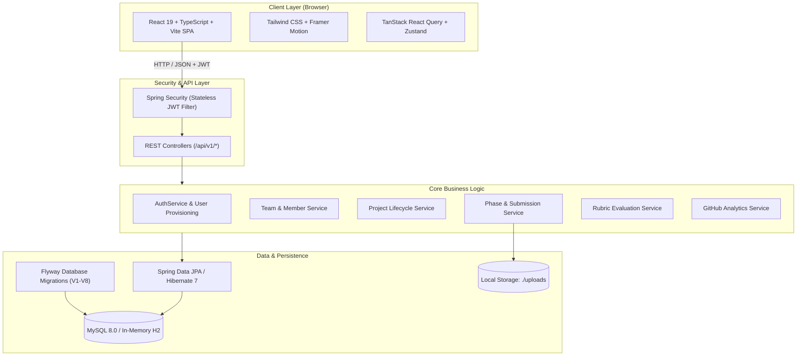

# 🎓 AcadTrack — Academic Project & Capstone Management Platform

[](https://spring.io/projects/spring-boot)
[](https://openjdk.org/)
[](https://react.dev/)
[](https://www.typescriptlang.org/)
[](https://tailwindcss.com/)
[](https://www.mysql.com/)
[](https://flywaydb.org/)
[](https://vitejs.dev/)

**AcadTrack** is an enterprise-grade academic lifecycle and capstone management platform designed for universities, colleges, and engineering departments. It streamlines and governs student team formation, project topic proposals, multi-stage milestone deliverables, rubrics-based grading evaluations, real-time GitHub repository analytics, and audit logging.

---

## 📑 Table of Contents

- [Key Features](#-key-features)
- [System Architecture](#-system-architecture)
- [Tech Stack](#-tech-stack)
- [Repository Structure](#-repository-structure)
- [Getting Started](#-getting-started)
  - [Prerequisites](#prerequisites)
  - [Backend Setup (AcadTrack)](#backend-setup-acadtrack)
  - [Frontend Setup](#frontend-setup)
- [Demo Credentials](#-demo-credentials)
- [REST API Reference](#-rest-api-reference)
- [Database Schema & Migrations](#-database-schema--migrations)
- [Testing & Verification](#-testing--verification)
- [Security & Governance](#-security--governance)

---

## ✨ Key Features

### 1. 🔐 Role-Based Access Control (RBAC) & Identity
- **Stateless JWT Authentication**: Secure BCrypt hashed credentials with claims-based authorization tokens.
- **Role Hierarchy**:
  - `ROLE_STUDENT`: Self-registration with University PNR, form/join teams, submit project proposals, upload phase deliverables.
  - `ROLE_GUIDE` / `ROLE_FACULTY`: Mentor assigned teams, assess milestone submissions, provide feedback.
  - `ROLE_COORDINATOR`: Administer academic cycles, approve/reject teams & project proposals, manage milestone phases, extend deadlines, and publish evaluation marks.
  - `ROLE_ADMIN`: Provision authorized coordinators securely.
- **Initial Coordinator Seed**: Bootstrapped automatically on first startup (`COORD001`).

### 2. 👥 Team Formation Governance
- Enforces institutional team constraints (configurable team sizes: 2 to 4 members).
- Validates student uniqueness per academic cycle (students cannot join multiple teams in the same cycle).
- Distinct roles within teams (`LEADER` vs `MEMBER`).
- Formal approval lifecycle: `DRAFT` ➔ `SUBMITTED` ➔ `UNDER_REVIEW` ➔ `APPROVED` / `REJECTED`.

### 3. 💡 Project Proposal & Approval Workflow
- Dedicated proposal registration per approved team (title, problem abstract, technology stack, GitHub URL).
- Formal review state machine with coordinator revision requests and feedback.
- Statuses: `PROPOSED` ➔ `UNDER_REVIEW` ➔ `APPROVED` / `REJECTED` / `CHANGES_REQUESTED`.

### 4. 📅 Phase Milestones & Rubric Evaluations
- **Dynamic Milestones**: Defined per academic cycle (e.g., Synopsis, Architecture Review, Mid-Term Defense, Final Viva).
- **Extension Auditing**: Tracks every deadline change, justification, and previous target dates (`PhaseDeadlineHistory`).
- **Customizable Rubrics**: Defined criteria per phase with maximum scores (e.g., Code Quality, Presentation, Architecture).
- **Draft & Release Marks**: Evaluators submit draft marks; coordinators publish final grades visible to students.

### 5. 🐙 Real-Time GitHub Repository Analytics
- Synchronizes with team repositories via GitHub REST API.
- Aggregates commit velocity, open/closed pull requests, open issues, stargazers, forks, active contributors, and primary programming languages.
- Safe offline fallback mock provider when external rate limits or offline sandboxes apply.

### 6. 📊 Responsive Dashboards & Audit Trails
- **Student Dashboard**: Real-time progress trackers, phase submission statuses, released scores, and team alerts.
- **Coordinator Dashboard**: Cycle statistics, team pending queues, proposal review queues, and grading summaries.
- **Security Audit Logs**: Captures user actions, target entities, IP addresses, and timestamps for accountability.

---

## 🏗 System Architecture



---

## 🛠 Tech Stack

| Layer | Technologies |
|---|---|
| **Backend** | Spring Boot 4.1.1, Java 24 / 27, Spring Security 7, Spring Data JPA, Hibernate 7 |
| **Migrations** | Flyway 12.4 (MySQL & H2 dialects) |
| **Frontend** | React 19, TypeScript 5.5, Vite 6, Tailwind CSS 3.4, Lucide React, Framer Motion |
| **State & API** | TanStack React Query v5, Zustand, Axios, React Hot Toast |
| **Database** | MySQL 8.0 (Production / Local), H2 (In-memory testing) |
| **Documentation** | SpringDoc OpenAPI 3.0 / Swagger UI |

---

## 📁 Repository Structure

```text
Mini-Project/
├── Project-Manager/
│   ├── AcadTrack/                       # Spring Boot 4 Backend
│   │   ├── src/main/java/com/projects/projectmanager/
│   │   │   ├── config/                  # Security & CORS configuration
│   │   │   ├── controller/              # RESTful API endpoints
│   │   │   ├── dto/                     # Request & Response records
│   │   │   ├── entity/                  # JPA entity models
│   │   │   ├── exception/               # Global exception handlers
│   │   │   ├── repository/              # Spring Data JPA repositories
│   │   │   ├── security/                # JWT Token Provider & Filter
│   │   │   └── service/                 # Domain business logic
│   │   ├── src/main/resources/
│   │   │   ├── db/migration/            # Flyway versioned SQL migrations (V1-V8)
│   │   │   └── application.properties   # Environment & database properties
│   │   ├── pom.xml                      # Maven project configuration
│   │   └── mvnw                         # Maven wrapper
│   │
│   ├── frontend/                        # React + TypeScript Frontend
│   │   ├── src/
│   │   │   ├── components/              # UI primitives (Cards, Badges, Modals, EmptyState)
│   │   │   ├── pages/
│   │   │   │   ├── auth/                # Login & Registration views
│   │   │   │   ├── coordinator/         # Coordinator dashboards, cycles, approvals
│   │   │   │   └── student/             # Student dashboard, team, project, submissions
│   │   │   ├── lib/                     # Axios API clients & utility formatters
│   │   │   ├── stores/                  # Zustand authentication store
│   │   │   └── types/                   # TypeScript domain interfaces
│   │   ├── package.json
│   │   └── vite.config.ts
│   │
│   └── test-all-apis.js                 # Complete 51-endpoint API verification script
└── README.md
```

---

## 🚀 Getting Started

### Prerequisites
- **Java JDK**: 21, 24, or 27 installed.
- **Node.js**: v18+ or v20+ with npm.
- **MySQL**: 8.0+ running locally (or use the built-in H2 profile).

---

### Backend Setup (AcadTrack)

1. Navigate to the backend directory:
   ```bash
   cd Project-Manager/AcadTrack
   ```

2. Configure Database:
   The backend connects to MySQL by default (`src/main/resources/application.properties`):
   ```properties
   spring.datasource.url=${DB_URL:jdbc:mysql://localhost:3306/project_manager?useSSL=false&serverTimezone=UTC&allowPublicKeyRetrieval=true}
   spring.datasource.username=${DB_USERNAME:HiDev}
   spring.datasource.password=${DB_PASSWORD:bookpass123}
   ```
   *Make sure a database named `project_manager` exists:*
   ```sql
   CREATE DATABASE IF NOT EXISTS project_manager;
   ```

3. Run the backend:
   ```bash
   # Run against MySQL (default)
   ./mvnw spring-boot:run

   # Alternatively, run standalone with in-memory H2 (no database setup needed)
   ./mvnw spring-boot:run -Dspring-boot.run.profiles=h2
   ```

The backend starts at `http://localhost:8080`.
OpenAPI documentation is available at `http://localhost:8080/swagger-ui.html`.

---

### Frontend Setup

1. Navigate to the frontend directory:
   ```bash
   cd Project-Manager/frontend
   ```

2. Install dependencies:
   ```bash
   npm install
   ```

3. Start development server:
   ```bash
   npm run dev
   ```

The frontend will be available at `http://localhost:5173`. Vite proxies API calls to `http://localhost:8080`.

---

## 🔑 Demo Credentials

When the backend starts up, an initial Project Coordinator account is automatically bootstrapped:

| Role | PNR / Username | Password |
|---|---|---|
| **Coordinator** | `COORD001` | `Coordinator@123` |
| **New Student** | Self-register at `/register` | Minimum 8 characters |

---

## 📡 REST API Reference

The backend exposes 51+ secure REST endpoints under `/api/v1/*`:

### Authentication & Admin
- `POST /api/v1/auth/login` — Authenticate and receive JWT token.
- `POST /api/v1/auth/register` — Register student account with university PNR.
- `POST /api/v1/admin/coordinators` — Admin provision of coordinator accounts.

### Academic Cycles & Phases
- `GET /api/v1/academic-cycles` — List cycles.
- `POST /api/v1/academic-cycles` — Create a new academic cycle.
- `GET /api/v1/phases?cycleId={id}` — List milestone phases.
- `POST /api/v1/phases` — Create milestone phase with submission deadlines.
- `PUT /api/v1/phases/{id}` — Extend phase deadline (audited).
- `POST /api/v1/phases/{id}/criteria` — Configure rubric grading criteria.

### Teams & Projects
- `POST /api/v1/teams` — Create student team.
- `POST /api/v1/teams/{id}/members` — Add member by PNR.
- `POST /api/v1/teams/{id}/submit` — Submit team for coordinator approval.
- `POST /api/v1/teams/{id}/approve` — Coordinator approval.
- `POST /api/v1/projects` — Propose capstone project for approved team.
- `POST /api/v1/projects/{id}/submit` — Submit project proposal for review.
- `POST /api/v1/projects/{id}/approve` — Approve project proposal.

### Deliverables & Evaluations
- `POST /api/v1/phases/{phaseId}/submissions` — Multipart deliverable upload (PDF/ZIP).
- `GET /api/v1/documents/{id}/download` — Download uploaded deliverable artifact.
- `POST /api/v1/submissions/{id}/evaluate` — Grade submission against defined rubrics.
- `POST /api/v1/evaluations/{id}/publish` — Publish evaluation marks to students.

### Analytics & Governance
- `GET /api/v1/projects/{id}/github` — Fetch GitHub activity snapshot.
- `GET /api/v1/dashboard/student` — Aggregate student progress data.
- `GET /api/v1/dashboard/coordinator` — Aggregate coordinator analytics.
- `GET /api/v1/audit-logs` — Query compliance and security audit logs.

---

## 🗄 Database Schema & Migrations

Database schema versioning is managed via Flyway SQL scripts located in `AcadTrack/src/main/resources/db/migration`:

- `V1__init_schema.sql`: Base tables for users, cycles, teams, members, and projects.
- `V2__create_phases_and_submissions.sql`: Milestone phases, deadline history, submissions, and documents.
- `V3__create_evaluations_and_criteria.sql`: Rubric evaluation criteria and student scores.
- `V4__create_notifications.sql`: System notification alerts.
- `V5__create_github_repositories.sql`: GitHub metric snapshots and history.
- `V6__create_audit_logs.sql`: Security and compliance audit logging.
- `V7__add_indexes.sql`: Performance indexes on foreign keys, PNRs, and statuses.
- `V8__add_coordinator_provisioning.sql`: Admin provisioning table.

---

## 🧪 Testing & Verification

### 1. JUnit Backend Test Suite
Run the 67 automated unit and integration tests:
```bash
cd Project-Manager/AcadTrack
./mvnw clean test
```
*Result: 67/67 passed (0 failures, 0 errors).*

### 2. End-to-End API Verification
With the backend running, execute the full workflow test runner:
```bash
cd Project-Manager
node test-all-apis.js
```
*Result: 51/51 endpoints verified successfully with full lifecycle state transitions.*

---

## 🔒 Security & Governance

- **Password Hashing**: BCrypt with salted rounds.
- **Token Security**: HMAC-SHA256 signed JWT tokens with expiration handling.
- **Access Control**: Method-level security with `@PreAuthorize("hasRole('COORDINATOR')")`.
- **CORS Support**: Whitelisted development origins (`localhost:3000`, `localhost:5173`).
- **File Validation**: MIME-type white-listing and 10MB payload size restriction on uploaded documents.

---

## 📄 License
This project is developed for academic project management and educational institutions.
